
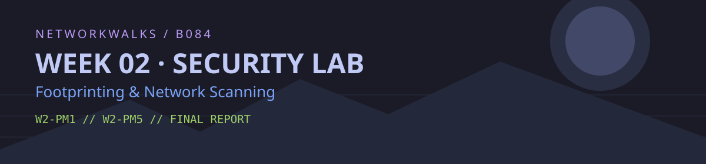

# Week 2 — Footprinting & Network Scanning

**Networkwalks Cybersecurity Internship · Batch B084**  
**Prepared by:** Muhammed Yaseen
**Date of practical:** 12 November 2026
**Environment:** Kali Linux (Oracle VirtualBox) 
**Modules:** W2-PM1 · W2-PM5 · W2-PM-FINAL

> **Scope note:** This is a record of my Week 2 learning activities, not a full penetration test or a claim that the target has been compromised. W2-PM1 used the domain named in the assignment (`networkwalks.com`); W2-PM5 used my local VirtualBox subnet (`10.0.0.0/24`). I did not attempt exploitation or verify vulnerabilities. Authorization should be confirmed with the internship coordinator; I have not claimed written permission in this report.

## 1. Introduction

For Week 2, I worked on two practical modules. The first involved collecting publicly available information about a domain with six Kali Linux tools. The second used Zenmap to discover active hosts on a local network and display them in a topology view.

I saved screenshots as I worked, then compared the results across tools. The main goal was to understand what reconnaissance can reveal and how to document observations without treating every exposed detail as a security weakness.

## 2. Tools and tasks

| Module | Tool | Purpose |
|:--|:--|:--|
| W2-PM1 | WHOIS | Domain registration information |
| W2-PM1 | WhatWeb | Publicly detectable website technologies |
| W2-PM1 | NSLookup | DNS name resolution |
| W2-PM1 | cURL | HTTP response headers |
| W2-PM1 | WAFW00F | WAF fingerprinting |
| W2-PM1 | DNSRecon | DNS record enumeration |
| W2-PM5 | Zenmap / Nmap | Local network host discovery and topology |

## 3. W2-PM1 — Footprinting and reconnaissance

**Target:** `networkwalks.com`  
**Approach:** Basic domain, DNS, and HTTP information gathering. Results below are from my own Kali session on 12 November 2026.

### 3.1 WHOIS

**Command:** `whois networkwalks.com`

The WHOIS output identified **GoDaddy.com, LLC** as the registrar. The domain was created on **6 November 2019**, and the record showed an expiry date of **6 November 2027**. It listed `NS6135.HOSTGATOR.COM` and `NS6136.HOSTGATOR.COM` as nameservers and marked DNSSEC as **unsigned**. The longer WHOIS response also contained registry and privacy-service details.

This was useful for understanding the domain's registration and DNS administration. It did not, by itself, reveal a vulnerability.

WHOIS screenshots (3)

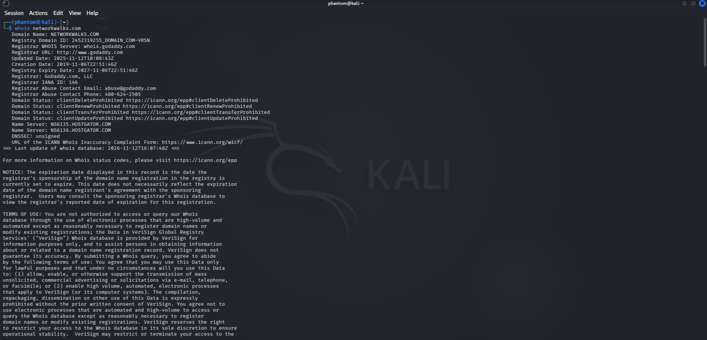
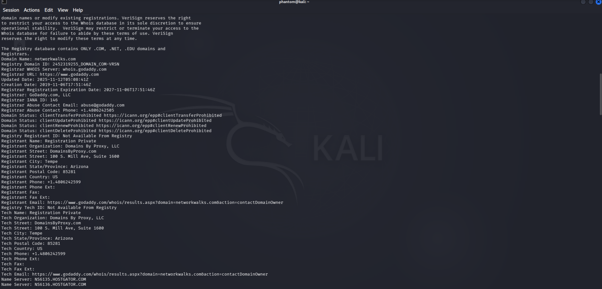
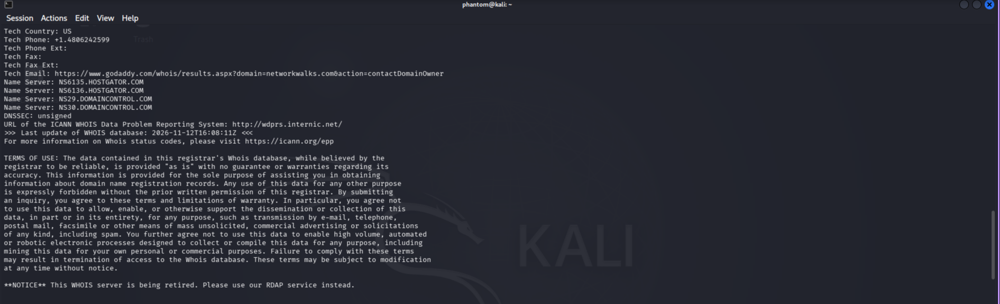

### 3.2 WhatWeb

**Command:** `whatweb networkwalks.com`

WhatWeb showed an **HTTP 301 redirect** to HTTPS and a successful **HTTP 200** response over HTTPS. Its fingerprints included **Apache**, **WordPress**, **jQuery 3.7.1**, and **Google Tag Manager**. It also reported the IP address `192.232.216.135` and the page title **NetworkWalks Academy**.

The tool displayed version-like strings such as `7.1.4` for some components. I have treated those as **unverified fingerprints**, not proof of the exact installed versions.

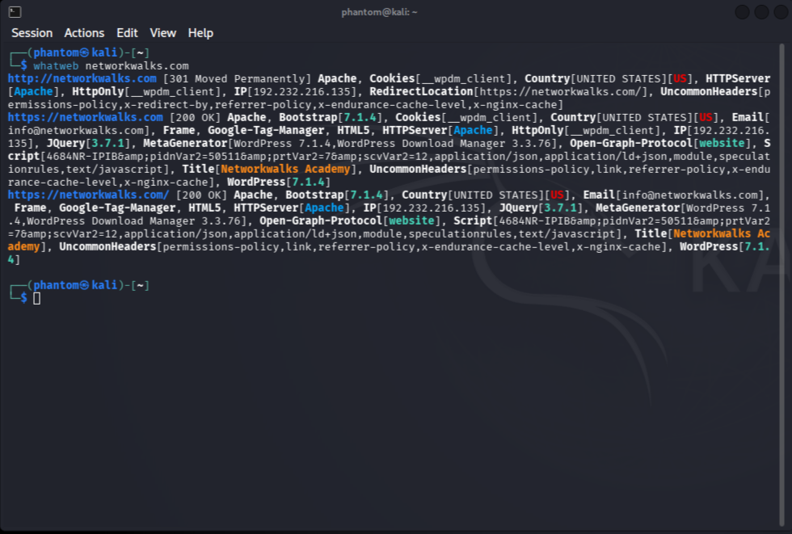

### 3.3 NSLookup

**Command:** `nslookup networkwalks.com`

Using the resolver `1.1.1.1`, NSLookup returned `192.232.216.135` for the domain. It was a **non-authoritative answer**, meaning the response came through a resolver rather than directly from an authoritative nameserver. The IP matched the address seen in WhatWeb.

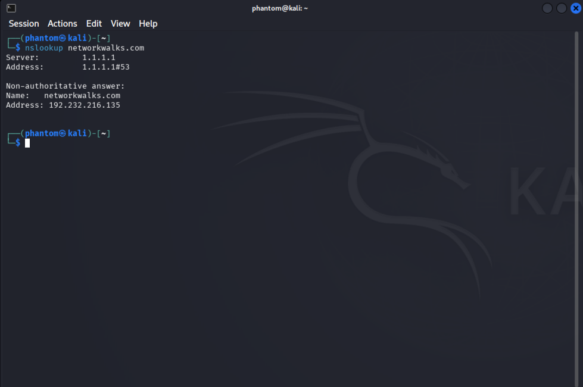

### 3.4 cURL — HTTP headers

**Command:** `curl -I https://networkwalks.com`

The site returned **HTTP/1.1 200 OK** and identified its server as **Apache**. The headers included WordPress REST API links, a cookie with **Secure** and **HttpOnly** flags, `Referrer-Policy: no-referrer-when-downgrade`, and `Content-Type: text/html; charset=UTF-8`.

The cookie flags are positive controls for the observed cookie. This one response is not enough to assess the site's full HTTP security configuration.

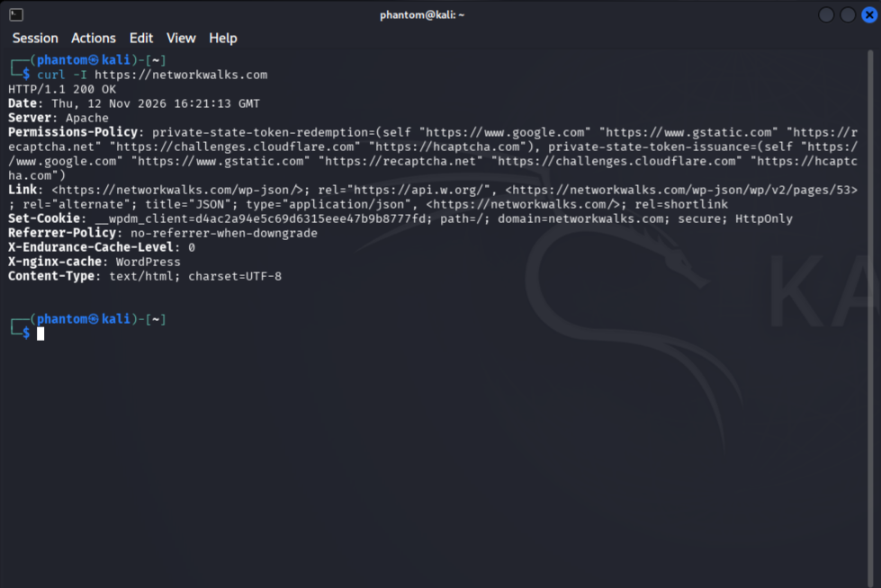

### 3.5 WAFW00F

**Command:** `wafw00f networkwalks.com`

WAFW00F **v2.4.2** identified **ModSecurity (SpiderLabs)** as the likely web application firewall and reported **2 requests**. This suggests WAF protection is present, but I did not test whether particular attacks would be blocked.

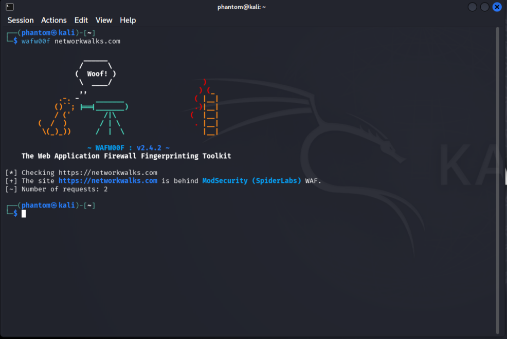

### 3.6 DNSRecon

**Command:** `dnsrecon -d networkwalks.com`

DNSRecon completed general enumeration and displayed several DNS record types:

| Record | Observation |
|:--|:--|
| A | `networkwalks.com` resolved to `192.232.216.135` |
| NS / SOA | HostGator nameservers appeared in the output |
| MX | `mail.networkwalks.com` |
| TXT | SPF-related text and a Google site-verification entry |
| SRV | Autodiscover-related records; the tool reported 8 records |
| DNSSEC | The query returned no answer; this was logged as an error, but enumeration continued |

This helped connect the website, mail, and DNS configuration. The output did not establish a DNS vulnerability. I have not copied the full verification token or SPF string into the report because the screenshot already preserves the evidence.

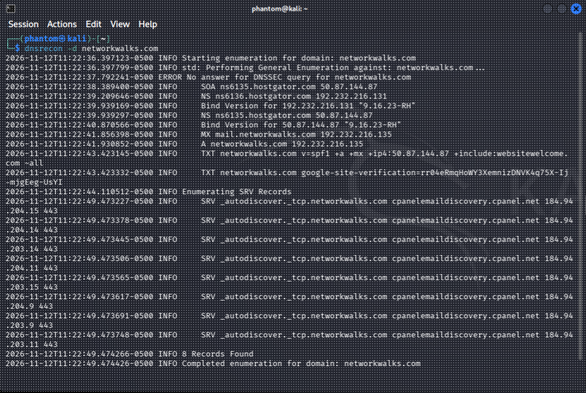

## 4. W2-PM5 — Network scanning with Zenmap

For the second module, I used **Zenmap**, the graphical interface for Nmap, inside my Kali VirtualBox VM. The `eth0` interface had the local address `10.0.0.2/24`, giving a subnet of `10.0.0.0/24`. This is the **virtual network used in my lab**, not evidence of devices on my wider home network.

**Profile:** Ping scan  
**Command shown by Zenmap:** `nmap -sn 10.0.0.0/24`

### 4.1 Live hosts

The scan checked **256 addresses** and reported **3 hosts up** in **4.16 seconds**.

| Host IP | Status | MAC address shown by Zenmap |
|:--|:--|:--|
| `10.0.0.1` | Up | `52:54:00:12:35:00` |
| `10.0.0.2` | Up (Kali VM) | Not shown in the scan |
| `10.0.0.3` | Up | `52:54:00:12:35:00` |

Zenmap showed the same MAC for `10.0.0.1` and `10.0.0.3`. I have kept the values exactly as displayed instead of assuming they belong to two distinct physical network cards. The MAC address of my Kali VM was not included in this scan output.

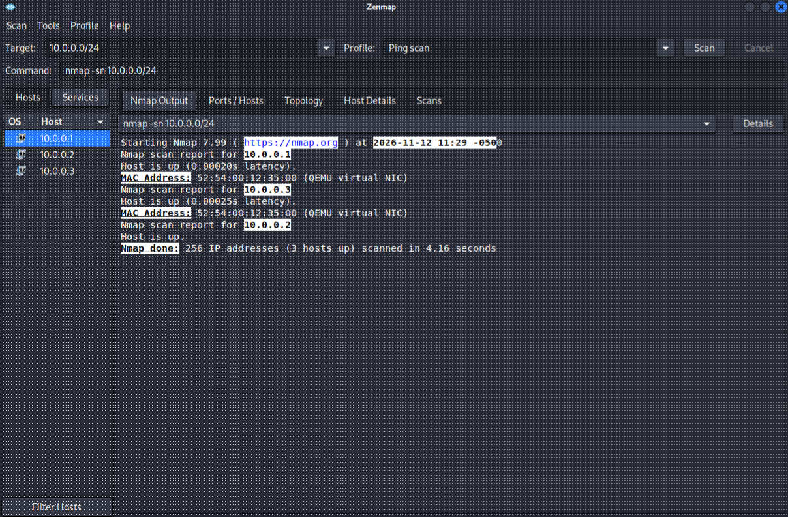

### 4.2 Network topology

I exported the topology view as a PDF, as required by the lab. It shows the three detected IP addresses around the local scanning host.

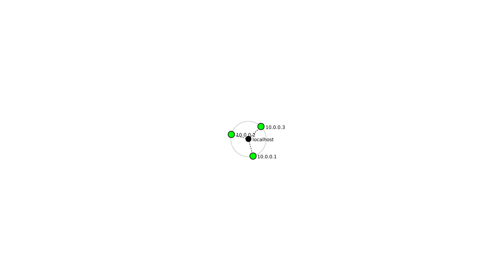

**[View the original Zenmap topology PDF](evidence/topology.pdf)**

### 4.3 Practice lab answers

| Task | Answer |
|:--|:--|
| 1 — Install Zenmap | Zenmap was installed and running on Kali Linux |
| 2 — Local IP and subnet | `10.0.0.2`, subnet `10.0.0.0/24` |
| 3 — Live host list | `10.0.0.1`, `10.0.0.2`, `10.0.0.3` |
| 4 — Number of live hosts | **3** |
| 5 — Host IP addresses | `10.0.0.1`, `10.0.0.2`, `10.0.0.3` |
| 6 — MAC addresses | Two displayed values (both `52:54:00:12:35:00`); Kali's own MAC not shown |
| 7 — Topology PDF | Exported and included in this repository; LinkedIn sharing is a separate submission step |

## 5. Findings and risk discussion

The activities in this report were primarily about **visibility and inventory**, not vulnerability validation. I did not perform exploitation, authentication testing, or a full security assessment.

| Observation | Why it matters | Assessment |
|:--|:--|:--|
| Registrar and nameservers visible through WHOIS | Normal public registration/DNS information | Informational |
| Website technologies identified by WhatWeb | Public fingerprints can help defenders review exposed version information | Informational; versions unverified |
| DNS records returned by DNSRecon | Shows public DNS and mail-routing configuration | Informational |
| DNSSEC listed unsigned in WHOIS | Worth checking whether DNSSEC deployment is appropriate for the domain | Configuration review; not a proven vulnerability |
| ModSecurity fingerprint detected | Indicates a possible protective WAF layer | Informational; effectiveness not tested |
| Three hosts found in VirtualBox subnet | Useful for understanding local network discovery | Lab observation, not a security finding |

No confirmed exploitable vulnerability was established by these tasks.

## 6. Recommendations

1. Keep the website platform, plugins, and server components updated, and verify versions through authorized administrative access rather than relying only on fingerprints.
2. Review public DNS records periodically to make sure they still match intended website and mail services.
3. Review the domain's DNSSEC configuration with the DNS administrator if signed DNS responses are part of the organization's requirements.
4. Maintain sensible HTTP security headers and cookie settings. The headers in this exercise are a starting point, not a complete audit.
5. Check WAF configuration and monitoring through approved administrative processes; detecting a WAF does not measure its effectiveness.
6. For network scans, record the subnet, host count, and scan date so later results can be compared accurately. Keep scanning limited to networks you own or have permission to assess.

## 7. Conclusion

This week helped me get more comfortable with practical reconnaissance tools and with reading their output instead of just running commands. WHOIS, WhatWeb, NSLookup, cURL, WAFW00F, and DNSRecon each showed a different part of the same public-facing domain. Some findings supported one another, especially the IP address and web server information.

Zenmap was a different kind of exercise. It showed me how a ping scan can find active hosts on a local subnet and how to turn the results into a simple topology diagram. The most important lesson was to **record what the tools actually show**, including gaps and uncertain results, rather than filling them in with guesses.

## 8. Evidence and references

- [Screenshots and topology files](evidence/)
- [W2-PM1 — Footprinting with Kali tools](https://networkwalks.com/)
- [Zenmap network scanning practice lab](https://networkwalks.com/zenmap-network-scanning-practice-lab/)
- [Nmap / Zenmap project](https://nmap.org/)

---

*Networkwalks Cybersecurity Internship · Week 2 · Batch B084 · `Muhammed Yaseen`*
